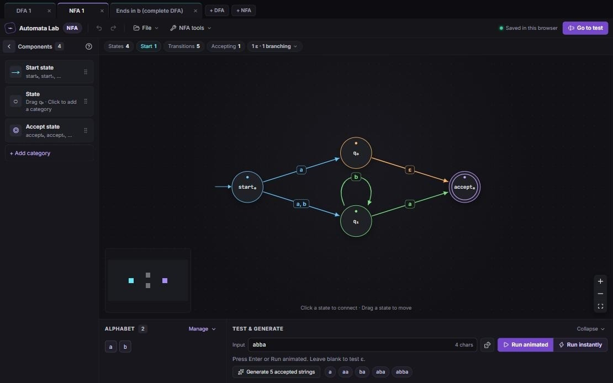
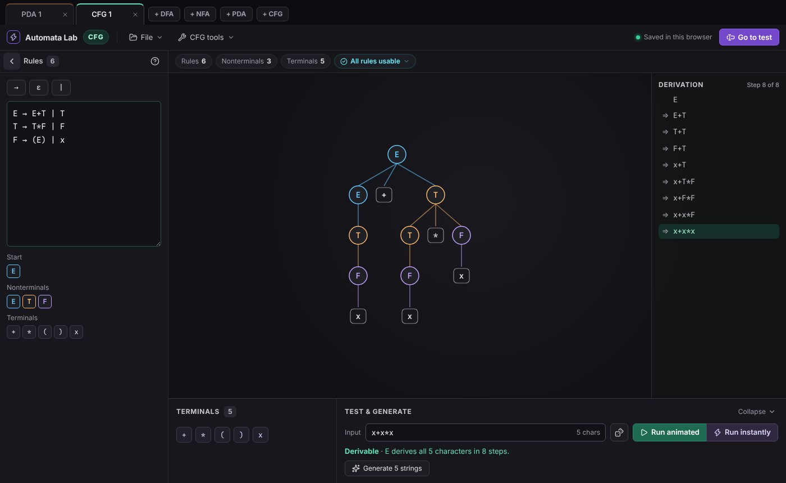
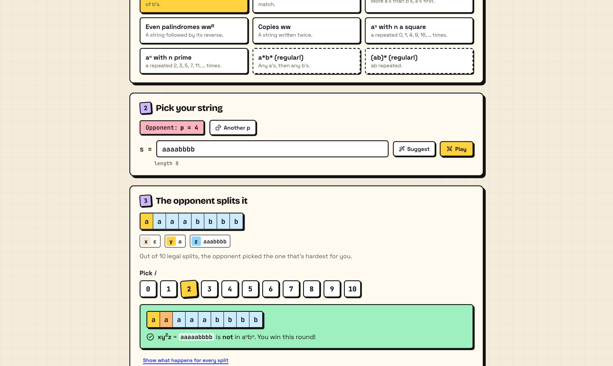
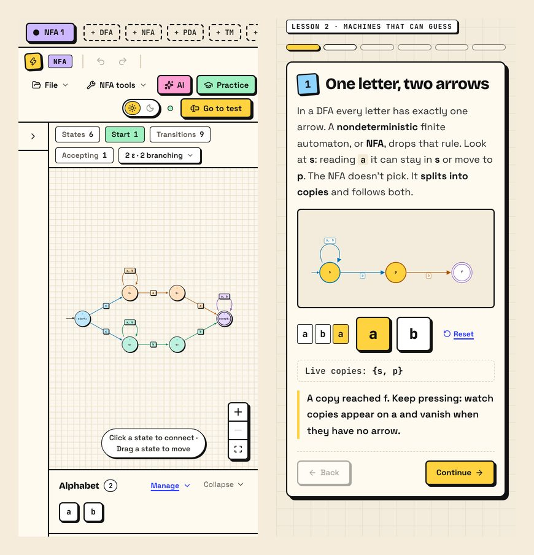
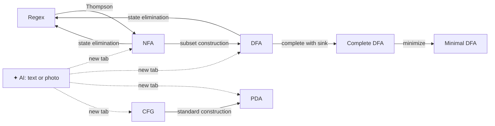

<div align="center">

# ⚡ Automata Lab

**Learn automata theory by building the machines yourself.**

Draw DFAs, NFAs, pushdown automata and Turing machines, write context-free grammars, and watch a string walk through each one until it's accepted or rejected. It comes with five hands-on lessons for complete beginners. Everything runs in your browser: no account, no server, and there's a cat.

[](https://xiaogao0616.github.io/lumina/)


</div>

## Where to start

| If you… | Go to |
| --- | --- |
| have never seen an automaton | [**The lessons**](https://xiaogao0616.github.io/lumina/learn/): five short ones, from your first DFA to grammars, about half an hour in all |
| want to check a homework machine or grammar | [**A workspace**](https://xiaogao0616.github.io/lumina/dfa/): draw it, run strings, convert it, export it |
| want practice that grades itself | **Practice** in any DFA/NFA toolbar: 12 languages, each answer checked exactly |
| are working on proofs | The [**pumping lemma game**](https://xiaogao0616.github.io/lumina/pumping/) and the [**deciders**](https://xiaogao0616.github.io/lumina/deciders/) from Sipser chapter 4 |

## 📖 Lessons

[`/learn`](https://xiaogao0616.github.io/lumina/learn/) follows Sipser chapters 1 and 2 and assumes nothing. Each step asks you to *do* something, like press buttons, tap a state, predict an answer, or write a regex or a grammar. **Continue** unlocks only once you've done it.

| # | Lesson | You will… |
| --- | --- | --- |
| 1 | [What is a DFA?](https://xiaogao0616.github.io/lumina/learn/dfa/) | open a two-button lock, look inside it, name the parts, and finish your first machine |
| 2 | [Machines that can guess](https://xiaogao0616.github.io/lumina/learn/nfa/) | watch an NFA split into copies, follow ε-arrows, and meet its subset-construction DFA |
| 3 | [Regular expressions](https://xiaogao0616.github.io/lumina/learn/regex/) | predict what union, concatenation and star match, then write a regex that's checked on every string up to length 7 |
| 4 | [What finite memory can't do](https://xiaogao0616.github.io/lumina/learn/nonregular/) | break a DFA that tries to count aⁿbⁿ and discover the pumping lemma yourself |
| 5 | [Grammars that grow strings](https://xiaogao0616.github.io/lumina/learn/cfg/) | derive strings by tapping rules, then write a grammar for even palindromes |

Your progress is saved in the browser. A lesson you leave halfway reopens on the step you still have to do. A lesson you've finished opens with every step unlocked, so you can jump back to any part of it.

<div align="center">

<br><sub>Lesson 2: press <b>a</b> and <b>b</b> and watch the NFA's copies split and die.</sub>
</div>

## 🧰 Five workspaces, one window

Each kind of machine gets its own workspace. They open as tabs side by side, so a grammar can sit next to the PDA you built from it. Conversions always open a **new tab**, so they never overwrite your work, and every tab saves itself as you go.

| Workspace | What's special there |
| --- | --- |
| [**DFA**](https://xiaogao0616.github.io/lumina/dfa/) | Diagnostics name every missing arrow. **Validate DFA** explains what's wrong in plain words and can fill the gaps with a sink state. Minimize, complement, convert to a regex. |
| [**NFA**](https://xiaogao0616.github.io/lumina/nfa/) | ε-moves and branching. Build one from a regex (Thompson's construction) and convert it to a DFA (subset construction). |
| [**PDA**](https://xiaogao0616.github.io/lumina/pda/) | Rules like `a, X → YZ` on the arrows, and a stack panel that follows the run move by move. |
| [**TM**](https://xiaogao0616.github.io/lumina/tm/) | Single-tape and deterministic, as in Sipser. A tape panel follows the head, and runs that loop are caught. Examples include `w#w`, `0^(2ⁿ)` and `aⁿbⁿcⁿ`. |
| [**CFG**](https://xiaogao0616.github.io/lumina/cfg/) | Type rules like `S → aSb \| ε` and get a parse tree and leftmost derivation. You can also convert to Chomsky normal form step by step, check for ambiguity, or convert to a PDA. |

**Every workspace can:**

- Add a state by dragging a component onto the canvas or just tapping it. Click one state, then another, to draw an arrow.
- **Run animated** to watch the string walk through the machine, or **Run instantly** for just the verdict.
- Generate accepted strings shortest-first, or fill in a random test string.
- Export JSON, SVG or LaTeX (TikZ), and make a **share link** that packs the whole tab into the URL.
- Undo and redo with `Ctrl+Z` / `Ctrl+Shift+Z`. A three-step tour runs the first time you open a workspace.

<table>
<tr>
<td width="50%"><br><sub>An NFA with ε-moves into two branches.</sub></td>
<td width="50%"><br><sub>Sipser's <code>w#w</code> machine, mid-run.</sub></td>
</tr>
<tr>
<td><br><sub>A grammar's parse tree and leftmost derivation.</sub></td>
<td><br><sub>A PDA in the dark theme, with its stack.</sub></td>
</tr>
</table>

## 🎓 Practice and proofs

- **Practice**: build a DFA or NFA for one of 12 languages. *Check my answer* decides exactly whether your machine is right, so any correct design passes. If it's wrong, it shows the shortest string it gets wrong. Solved exercises keep their check mark, and **Open** takes you back to the tab where you built one.
- **Compare or combine** two tabs: test whether they're equivalent (with the shortest counterexample), or build their union, intersection or difference.
- **Pumping lemma game**: the computer picks *p* and the split, and you pick *s* and *i*. A table shows whether your *s* beats every split, and the languages you've won on get a badge.
- **Deciders** (Sipser chapter 4): A<sub>DFA</sub>, A<sub>NFA</sub>, A<sub>REX</sub>, E<sub>DFA</sub>, EQ<sub>DFA</sub>, A<sub>CFG</sub> and E<sub>CFG</sub>, each run the way the proof does it, step by step, along with why it always halts. A last panel shows why A<sub>TM</sub> has none.

<table>
<tr>
<td width="50%"><br><sub>Practice names the shortest string you get wrong.</sub></td>
<td width="50%"><br><sub>The pumping lemma as a two-player game.</sub></td>
</tr>
</table>

## ✦ Build with AI

The pink **✦ AI** button builds a machine from a description ("strings over {a, b} that end in ab") or from a photo of a hand-drawn diagram. You can choose the machine type or let the model pick. It runs in the background while you keep working.

The result has to pass the same checks as an imported file before it opens in a new tab. Busy servers are retried, and broken answers are repaired or sent back to the model once. If something still fails, the error says what to do: check the key, wait out the quota, or rephrase.

It uses **your own API key**, called straight from the browser: Google Gemini (free key from [AI Studio](https://aistudio.google.com/apikey)), Anthropic, or any OpenAI-compatible endpoint. The key stays in this browser and goes only to the address you set.

## 📱 On a phone, too

On a narrow screen the canvas takes the full width and the page scrolls, with the panels underneath. The components panel tucks into a side rail. Since phones can't drag, tapping a component drops a new state into an empty spot. The lessons work on a phone as well.

<div align="center">

</div>

## 🌗 The look

It's neo-brutalist on purpose: thick ink outlines, hard shadows, a grid-paper canvas, with Bricolage Grotesque, Space Grotesk and JetBrains Mono for type. Light and dark themes are remembered and never flash on load.

A cat sits at the corner of the canvas. It follows your pointer, cheers when a string is accepted, sulks when one is rejected, and falls asleep if you leave it alone.

## 🚀 Run it yourself

```bash
git clone https://github.com/xiaogao0616/lumina.git
cd lumina
npm install
npm run dev          # http://localhost:3000
```

```bash
npm test             # 156 tests with node --test
npm run typecheck    # route types + tsc --noEmit
npm run build        # static export into out/
```

Every push to `main` is built and published to GitHub Pages by [`deploy.yml`](.github/workflows/deploy.yml). The site lives under `/lumina`, so the workflow builds with `NEXT_PUBLIC_BASE_PATH=/lumina`. Locally the variable is empty and the app runs at `/`.

<details>
<summary><b>Three short walkthroughs</b></summary>

**Regex → NFA → minimal DFA**
1. Open **NFA**, then **NFA tools → Regex → NFA…**, type `a(b|c)*d` and press **Generate**.
2. Run `abcbd` animated and watch it reach the accept state.
3. **NFA tools → Convert to DFA** opens the deterministic version in a new tab. **DFA tools → Minimize** shrinks it.

**Watch a PDA use its stack**
1. Open **PDA**. It starts with a machine for palindromes over `{a, b}`.
2. Run `abbba` animated. `$` goes on first, the first half is pushed, the machine guesses the middle, and then the stack is popped one symbol per character.
3. Try `abab`: no guess of the middle works, so it's rejected.

**From a grammar to a PDA**
1. Open **CFG**, then **CFG tools → Example: Arithmetic expressions**.
2. Run `x+x*x` and watch the parse tree grow alongside the leftmost derivation.
3. **CFG tools → Convert to PDA** opens the equivalent PDA. Run the same string there.

</details>

<details>
<summary><b>Notation</b> (Sipser's conventions)</summary>

**DFA.** Exactly one arrow for every state and letter, and no ε. Validate and tests wait until the machine is complete. **Complete with sink** adds the missing arrows for you.

**PDA rules** are `a, X → YZ`: read `a`, pop `X`, push `YZ`.
- Any part can be ε.
- The first pushed character ends up on top.
- The stack starts empty, so most machines begin with `ε, ε → $`.
- A string is accepted when all of it is read and some run is in an accepting state. The stack doesn't need to be empty.
- Runs are searched breadth-first with a cap on stack depth. If a run hits the cap, the result says so.

**TM rules** are `0 → x, R`: read, write, move. `_` is the blank ⊔.
- The tape is infinite to the right, and moving left from the first cell stays put.
- Entering an accepting state accepts. A missing rule rejects.
- A repeated configuration is reported as looping forever. A run with no verdict after 20,000 moves stops there.

**Grammars** use one or more rules per line, like `S → aSb | ε`.
- `->` and `::=` also work for the arrow.
- Nonterminals are single uppercase letters. Every other character is a terminal, and spaces are ignored.
- `ε` or an empty alternative is the empty string.
- The first rule's left side is the start symbol.
- Lines starting with `#` or `//` are comments.

</details>

<details>
<summary><b>Under the hood</b></summary>

All the theory is plain, tested TypeScript in [`lib/`](lib/), kept apart from the UI. The lessons reuse it through `components/lesson-kit.tsx`.

| Module | What it does |
| --- | --- |
| `automata-simulator.ts` | Accept or reject, following ε-closures |
| `automata-dfa.ts` | DFA rules: conflicts, missing arrows, completing with a sink |
| `nfa-to-dfa.ts` / `dfa-minimize.ts` | Subset construction, and minimization of reachable states |
| `regex-to-nfa.ts` | Thompson construction for `\| * + ? ( )` and `\` escapes |
| `regular-ops.ts` | Equivalence with shortest counterexamples, product constructions, complement, state elimination to regex |
| `pda.ts` / `turing.ts` | Bounded runs with the stack or tape at every move, examples, branching and loop detection |
| `cfg.ts` / `cfg-transform.ts` | Grammar parsing and checks, Earley parsing with a parse tree, CFG → PDA, Chomsky normal form, ambiguity search |
| `deciders.ts` / `decider-examples.ts` | The chapter 4 deciders with a trace of every stage |
| `exercises.ts` / `pumping.ts` | The practice checker, and the pumping lemma game's languages and splits |
| `accepted-strings.ts` / `path-animation.ts` | Accepted strings in shortlex order, and the walks behind the animation |
| `ai-automaton.ts` | Prompts for the AI builder, plus repair and validation of what comes back |
| `edge-geometry.ts` / `graph-svg.ts` / `graph-tikz.ts` | Edge routing, SVG export and TikZ/LaTeX export |
| `editor-storage.ts` / `share-link.ts` / `lessons.ts` | Validated local saves, share links, and lesson progress |



</details>

---

<div align="center">
<sub>Built with Next.js and React Flow · Your work never leaves your browser unless you ask the AI</sub>
</div>
