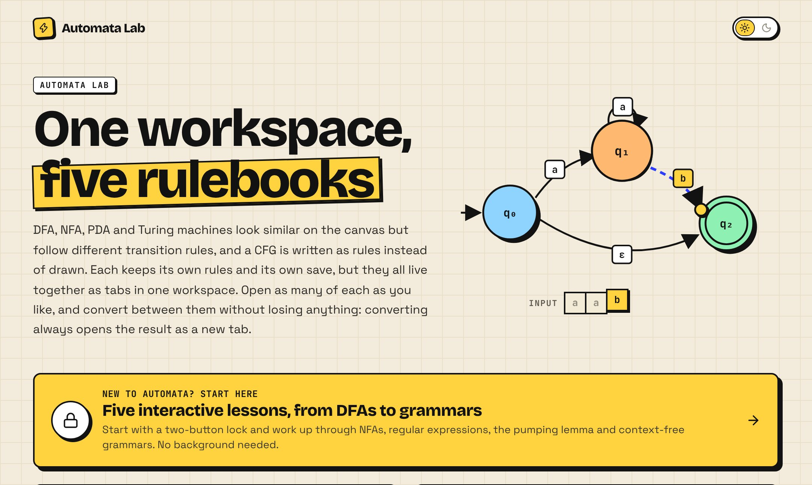
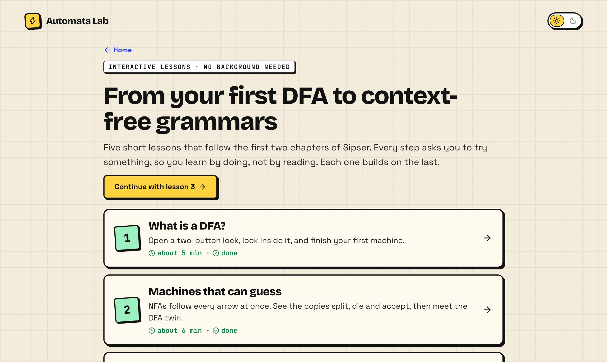
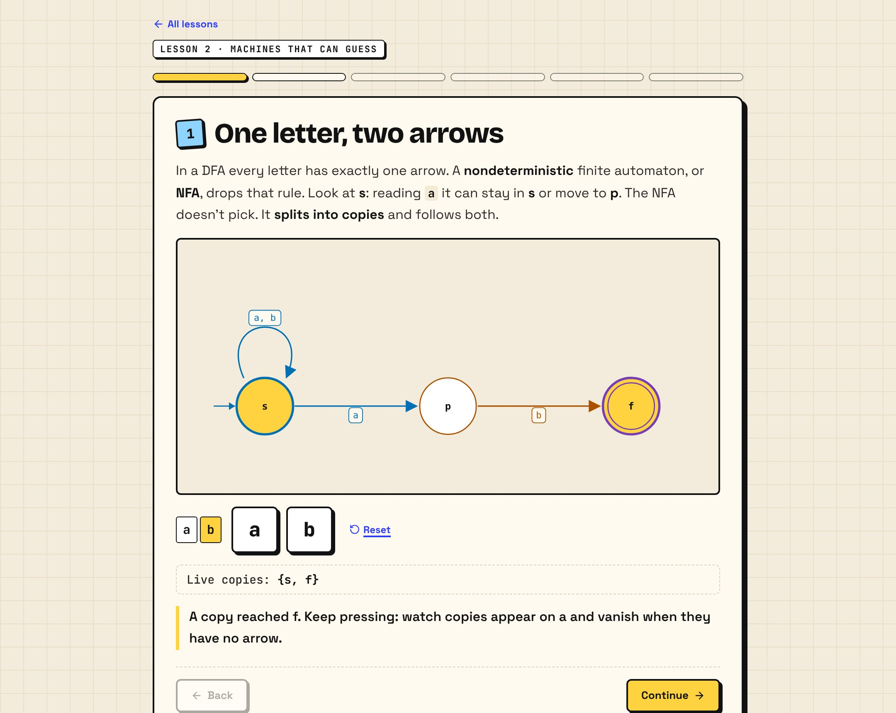
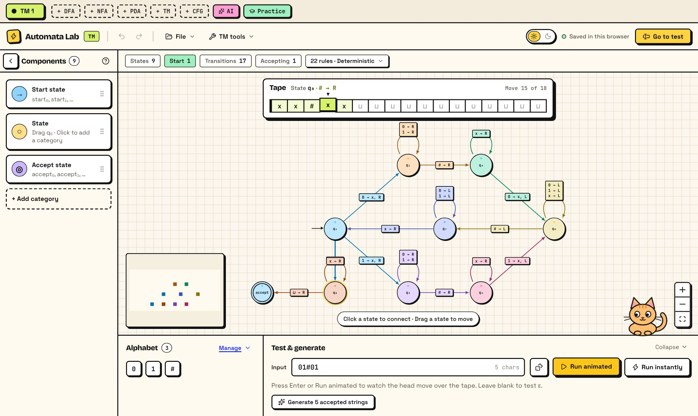
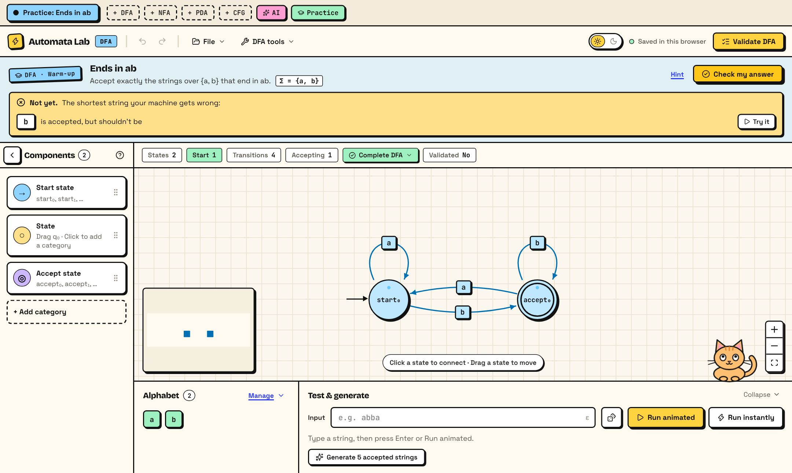
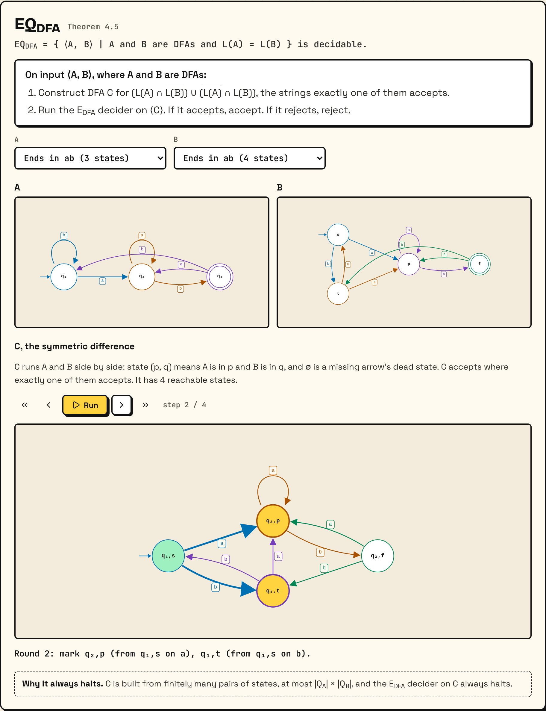
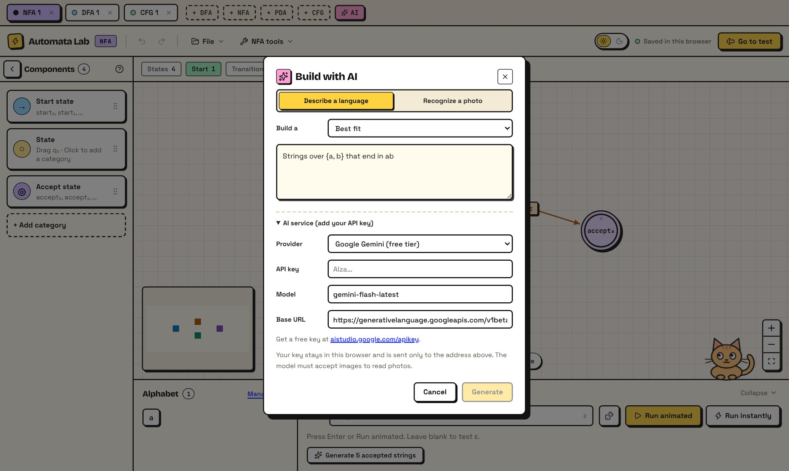
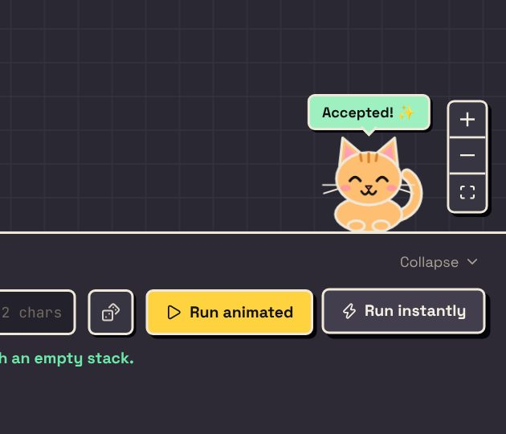
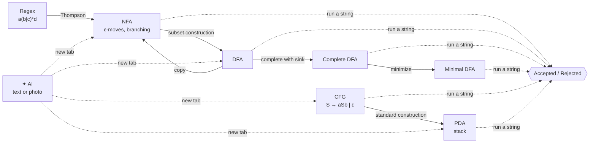

<div align="center">

# ⚡ Automata Lab

**Learn automata theory by doing it: draw DFAs, NFAs, PDAs and Turing machines, write grammars, and watch strings walk through them.**

A loud, hands-on DFA / NFA / PDA / TM / CFG workbench with five interactive lessons for complete beginners. It runs entirely in your browser. No account, no backend, and a cat.

[](https://xiaogao0616.github.io/lumina/)




</div>

---

## What is it?

A whiteboard for **automata theory**. Drag states onto a canvas, click to connect them, label the arrows, then type a string and **watch it move through the machine** until it is accepted or rejected. For grammars you type the rules instead and watch the parse tree grow.

It's made for students learning formal languages, TAs who need a quick example, and anyone who wants to check a homework DFA, PDA, Turing machine or grammar before handing it in.

**Never seen an automaton?** Start with the [interactive lessons](https://xiaogao0616.github.io/lumina/learn/). They take you from your first DFA to context-free grammars in about half an hour, one small task at a time.

Five workspaces share one window as tabs, so a grammar can sit right next to the PDA you built from it.

| Workspace | Open it | What you do there |
| --- | --- | --- |
| **DFA** | [`/dfa`](https://xiaogao0616.github.io/lumina/dfa/) | Draw a deterministic automaton, find missing transitions, complete it with a sink, minimize it |
| **NFA** | [`/nfa`](https://xiaogao0616.github.io/lumina/nfa/) | Use ε-moves and branching, build one from a regex, convert it to a DFA |
| **PDA** | [`/pda`](https://xiaogao0616.github.io/lumina/pda/) | Put stack rules on the arrows and watch the stack change move by move |
| **TM** | [`/tm`](https://xiaogao0616.github.io/lumina/tm/) | Write read/write/move rules on the arrows and watch the head work along the tape |
| **CFG** | [`/cfg`](https://xiaogao0616.github.io/lumina/cfg/) | Write rules as text, get a parse tree and leftmost derivation, convert to a PDA |

<div align="center">

<br><sub>An NFA tab, starting with a machine for strings that contain <code>aa</code> or <code>bb</code>. Every workspace gets its own colour: blue for DFA, violet for NFA, orange for PDA, lime for TM, green for CFG.</sub>
</div>

## 📖 Learn from zero

Automata theory is hard to pick up from a canvas alone, so [`/learn`](https://xiaogao0616.github.io/lumina/learn/) has five short lessons in the style of Brilliant. They follow Sipser chapters 1 and 2 and need no background. Every step asks you to do something (press buttons, tap a state, predict an answer, write a regex or a grammar) and Continue unlocks only once you've done it. The lesson page ticks the ones you've finished.

| # | Lesson | What you do |
| --- | --- | --- |
| 1 | [**What is a DFA?**](https://xiaogao0616.github.io/lumina/learn/dfa/) | Open a two-button lock, look inside it, name the parts, predict accept or reject, spot a missing arrow, and finish your first machine |
| 2 | [**Machines that can guess**](https://xiaogao0616.github.io/lumina/learn/nfa/) | Watch an NFA split into copies, find which copies survive, follow ε-arrows, and find the matching state in its subset-construction DFA |
| 3 | [**Regular expressions**](https://xiaogao0616.github.io/lumina/learn/regex/) | Predict what union, concatenation and star match, read regexes aloud, write one that's checked on every string up to length 7, and see each regex's smallest DFA |
| 4 | [**What finite memory can't do**](https://xiaogao0616.github.io/lumina/learn/nonregular/) | Break a DFA that tries to count aⁿbⁿ, find the state that must repeat, and pump the loop: the pumping lemma, discovered step by step |
| 5 | [**Grammars that grow strings**](https://xiaogao0616.github.io/lumina/learn/cfg/) | Derive strings by tapping rules, see a grammar generate aⁿbⁿ and balanced parentheses, and write a grammar for even palindromes |

Turing machines and decidability come later as lessons. Until then there's the TM workspace and the [deciders page](https://xiaogao0616.github.io/lumina/deciders/).

The first time you open a workspace, a **three-step quick tour** shows how to add states, draw transitions and test a string. The `?` in the Components panel brings it back.

<div align="center">

<br><sub>The lesson page remembers which lessons you've finished.</sub>
<br><br>

<br><sub>Lesson 2: press <b>a</b> and <b>b</b> and watch the NFA's copies split and die.</sub>
</div>

## ✨ Features

<table>
<tr>
<td width="50%" valign="top">

### 🎨 Build
- Drag-and-drop **start / normal / accept** states
- Click a state, then a target, to draw a transition; put **several characters** on one arrow
- Custom state categories (`r₀, r₁, …`), each made as start, plain or accept states
- Change a placed state's kind from its hover menu: toggle **accepting**, or **make it the start state**. Its transitions stay put
- A start state can also accept
- Drag a state back onto the side panel to delete it; the panel turns into a big **delete zone** while you drag
- Undo / redo (`Ctrl+Z` / `Ctrl+Shift+Z`)

</td>
<td width="50%" valign="top">

### ▶️ Test
- **Run animated**: the string walks state by state, and NFA branches are tried one at a time
- **Run instantly**: the verdict without the walk
- 🎲 Fill in a random string from the alphabet in use
- ✨ **Generate accepted strings**, shortest first; each click shows the next 5
- Live diagnostics: missing transitions, conflicts, ε-moves, branching

</td>
</tr>
<tr>
<td valign="top">

### 🔁 Transform
- **NFA → DFA** by subset construction
- **DFA → NFA** copy
- **Minimize** a DFA (Moore partition refinement)
- **Complete with sink**: fills every missing transition
- **Regex → NFA** with Thompson's construction (`| * + ? ( )`, `\` escapes)
- **CFG → PDA** by the standard construction

</td>
<td valign="top">

### 💾 Keep
- Browser-style **tabs**: mix as many DFAs, NFAs, PDAs and grammars as you like
- Conversions always open a **new tab** and never overwrite your work
- Every tab is saved automatically in your browser
- Import / export **JSON**
- Export a clean **SVG** for slides and homework

</td>
</tr>
<tr>
<td valign="top">

### 📚 Pushdown automata
- Each arrow rule reads a character, pops a symbol and pushes a string (`a, X → YZ`), any part ε
- A **stack panel** follows the animated run move by move
- Diagnostics list the rule pairs that make the PDA nondeterministic
- Examples: `aⁿbⁿ` and even palindromes `wwᴿ`

</td>
<td valign="top">

### ✍️ Context-free grammars
- Write rules as text: `S → aSb | ε`
- Test a string and get its **parse tree** and **leftmost derivation**, animated step by step
- Flags undefined, non-productive and unreachable nonterminals
- Generate the shortest strings the grammar derives
- Convert to **Chomsky normal form**, one Sipser step at a time
- **Ambiguity check**: finds the shortest string with two parse trees and shows both

</td>
</tr>
</table>

### 🖨️ Turing machines
- Single-tape and deterministic, as in Sipser chapter 3. Each rule reads the symbol under the head, writes one and moves L or R (`0 → x, R`; leave Write empty to keep the symbol, giving `0 → 0, R`). `_` types the blank ⊔.
- The tape is infinite to the right and the head stays put if it moves left off the first cell. An accepting state halts and accepts; a missing rule rejects, so there's no reject state to draw.
- A **tape panel** follows the run cell by cell. A run that repeats a configuration is reported as **looping forever**, and one that goes 20,000 moves without halting gets **no verdict**.
- Examples: Sipser's `w#w` and `0^(2ⁿ)`, `aⁿbⁿcⁿ` (not context-free) and unary addition. The ✦ AI button builds a Turing machine from a description too.

<div align="center">

<br><sub>A Turing machine tab running Sipser's machine for <code>w#w</code>. The tape panel shows the head and what it has crossed off.</sub>
</div>

<div align="center">

<br><sub>A grammar tab: rules on the left, the parse tree and leftmost derivation of <code>x+x*x</code> on the right.</sub>
<br><br>

<br><sub>Diagnostics name every (state, character) pair that's still missing, so you know what's left before the DFA is complete.</sub>
</div>

## 🎓 Practice and proofs

- **Practice mode** (the green **Practice** button in the toolbar): twelve languages to build a DFA or NFA for. *Check my answer* compares your machine with the reference exactly and names the shortest string it gets wrong.
- **Compare or combine** two tabs: an equivalence check with shortest counterexamples, plus union, intersection and difference by product construction, and complement.
- **DFA/NFA → regex** by state elimination, in the same syntax Regex → NFA reads.
- **Pumping lemma game** at `/pumping`: the computer picks *p* and the split, you pick *s* and *i*, and a table shows whether your *s* wins against every split.
- **Deciders** at `/deciders` (Sipser chapter 4): A<sub>DFA</sub>, A<sub>NFA</sub>, A<sub>REX</sub>, E<sub>DFA</sub>, EQ<sub>DFA</sub>, A<sub>CFG</sub> and E<sub>CFG</sub>, each run the way the book's proof does it and replayed step by step on an example or one of your own tabs, with the reason it always halts. A last panel shows why A<sub>TM</sub> has no decider.
- **Share link** packs a tab into the URL, and **Export LaTeX** writes a TikZ picture of an automaton or an `align*` block of a grammar for homework.

<div align="center">

<br><sub>Practice mode: the check names the shortest string your machine gets wrong.</sub>
<br><br>

<br><sub>The pumping lemma game: the opponent picks the split, you pick <i>i</i>.</sub>
<br><br>

<br><sub>The EQ<sub>DFA</sub> decider: build C for the symmetric difference, then mark what's reachable.</sub>
</div>

## ✦ Build with AI

Click the pink **✦ AI** button in the toolbar, next to the tools menu. You can **describe a language** ("strings over {a, b} that end in ab") or **take or choose a photo** of a hand-drawn diagram or grammar.

- Pick DFA, NFA, PDA, Turing machine or CFG, or let the model choose. The run shows as a striped placeholder tab, so you can keep working while it thinks.
- The result opens in a new tab after the same checks as an imported file: one start state, single-character symbols, a DFA that's really deterministic, grammar rules that parse.
- It uses your own API key, called straight from the browser: Google Gemini (free key from [AI Studio](https://aistudio.google.com/apikey)), Anthropic (Claude), or any OpenAI-compatible endpoint with a vision model. The key stays in this browser's local storage and goes only to the address you set.

<div align="center">

</div>

## 🌗 Light, dark, and a cat

The look is neo-brutalist on purpose: thick ink outlines, hard offset shadows, a grid-paper canvas, Bricolage Grotesque headlines with Space Grotesk and JetBrains Mono underneath.

- **Light and dark themes** with a sliding switch on the home page and in every workspace. The choice is remembered, and the page never flashes the wrong theme on load.
- **The home page automaton is alive**: a token runs `aab`, `ab` and `ε` through a small NFA, reading the tape and popping *accepted ✓* at the end.
- **A workspace cat** sits at the corner of the canvas. Its eyes follow your pointer, it purrs when you click it, cheers when a string is accepted, sulks when one is rejected, stares while a run animates, and falls asleep if you leave it alone. Tuck it away with its ✕; a paw button brings it back.

<div align="center">

<br><sub>The dark theme, with a PDA mid-run. The stack panel shows the stack after each move.</sub>
<br><br>

</div>

## 🧭 How the pieces fit



## 🚀 Try it

**In the browser:** open the [live demo](https://xiaogao0616.github.io/lumina/). There's nothing to install. New to the subject? Begin with [lesson 1](https://xiaogao0616.github.io/lumina/learn/dfa/).

**Locally:**

```bash
git clone https://github.com/xiaogao0616/lumina.git
cd lumina
npm install
npm run dev        # → http://localhost:3000
```

<details>
<summary><b>Walkthrough: regex → NFA → minimal DFA</b></summary>

1. Open **NFA** and pick **NFA tools → Regex → NFA…**
2. Type `a(b|c)*d` and press **Generate**.
3. Enter `abcbd` in the input and press **Run animated**. Watch it reach the accept state.
4. **NFA tools → Convert to DFA** opens the deterministic version in a new tab.
5. In that tab, use **DFA tools → Minimize** to see how small the machine can get.

</details>

<details>
<summary><b>Walkthrough: watch a PDA use its stack</b></summary>

1. Open **PDA**. It starts with a machine for every palindrome over `{a, b}`.
2. Enter `abbba` and press **Run animated**. The stack panel in the corner shows `$` go on first, then `a` and `b` as the first half is read. At the middle `b` the machine guesses it is halfway, skips that character, and pops one symbol for each character after it.
3. Try `abab`. No guess of the middle lets the second half match the stack, so it never reaches the accept state.
4. Click an arrow to add or remove rules. Leave **Read**, **Pop** or **Push** blank for ε.
5. **PDA tools → Example: aⁿbⁿ** loads a smaller machine. Open the diagnostics pill above the canvas on the palindrome PDA to see the rule pairs that branch.

</details>

<details>
<summary><b>Walkthrough: from a grammar to a PDA</b></summary>

1. Open **CFG** and pick **CFG tools → Example: Arithmetic expressions**.
2. Enter `x+x*x` and press **Run animated**. The parse tree grows in the same order as the leftmost derivation on the right.
3. Press **Generate 5 strings** a few times. Each click shows the next five, shortest first, and starts over when the list runs out.
4. **CFG tools → Convert to PDA** opens the equivalent PDA in a new tab. Run `x+x*x` there too and watch the stack.

</details>

## 📐 Notation

The PDA and CFG workspaces follow the conventions in Sipser's *Introduction to the Theory of Computation*.

**PDA rules** are written `a, X → YZ`: read `a`, pop `X`, push `YZ`.
- Any of the three parts can be ε, which means "don't read", "don't pop" or "push nothing".
- The pushed string's first character ends up on top, so pushing `YZ` leaves `Y` above `Z`.
- The stack starts empty. Most machines begin with `ε, ε → $` to mark the bottom.
- A string is accepted when all of it has been read and some run is in an accepting state. The stack doesn't have to be empty.
- Runs are searched breadth-first with a cap on stack depth, so an ε-loop that keeps pushing can't freeze the page. If the cap is hit, the result says so.

**Grammars** are written one or more rules per line, like `S → aSb | ε`.
- `->` and `::=` work as well as `→`. The toolbar has buttons for `→`, `ε` and `|`.
- Nonterminals are single uppercase letters `A`–`Z`. Every other character is a terminal, and spaces are ignored.
- `ε` or an empty alternative is the empty string.
- The first rule's left side is the start symbol. Another line for the same letter adds more alternatives.
- Lines starting with `#` or `//` are comments.

## 🧠 Under the hood

All the theory lives in plain, tested TypeScript under [`lib/`](lib/), separate from the UI. The lessons reuse it too: `components/lesson-kit.tsx` holds their shared diagram, answer widgets and step shell.

| Module | What it does |
| --- | --- |
| `automata-simulator.ts` | Decides accept / reject, following ε-closures |
| `nfa-to-dfa.ts` | Subset construction; missing moves go to an ∅ sink |
| `dfa-minimize.ts` | Moore / table-filling minimization of reachable states |
| `regex-to-nfa.ts` | Thompson construction for a small regex dialect |
| `automata-dfa.ts` | DFA rules: conflicts, missing transitions, sink completion |
| `path-animation.ts` | Enumerates the walk(s) a string takes, for the animation |
| `accepted-strings.ts` | Lists accepted strings in shortlex order, five at a time |
| `pda.ts` | PDA rules, a bounded breadth-first run with the stack at every move, examples, branching |
| `turing.ts` | Turing machine rules, a run with the tape at every move, loop detection, examples |
| `cfg.ts` | Grammar parsing and checks, Earley membership with a parse tree, string generation, CFG → PDA |
| `ai-automaton.ts` | Prompts for the AI builder and validation of what the model sends back |
| `automaton-graph.ts` | Shared graph types, state colours and theme-aware ink |
| `edge-geometry.ts` / `graph-svg.ts` | Edge routing on the canvas, and standalone SVG export with the same routing |
| `regular-ops.ts` | Equivalence with shortest counterexamples, product constructions, complement, state elimination to regex |
| `cfg-transform.ts` | Chomsky normal form with every step, and a bounded ambiguity search |
| `deciders.ts` / `decider-examples.ts` | The chapter 4 deciders with a trace of every stage, and their example inputs |
| `exercises.ts` / `pumping.ts` | Practice exercises and their checker; languages and splits for the pumping lemma game |
| `share-link.ts` / `graph-tikz.ts` | Compressed share links; TikZ and LaTeX export |
| `lessons.ts` | The lesson list and the progress saved in this browser |
| `editor-storage.ts` | Versioned, validated local saves and tab index |

```bash
npm test           # 150 tests, node --test
npm run typecheck  # route types + tsc --noEmit
npm run build      # static export into out/
```

## 📦 Deployment

Every push to `main` is built as a static export and published to GitHub Pages by [`deploy.yml`](.github/workflows/deploy.yml). The site lives under `/lumina`, so the workflow passes that path to the build as `NEXT_PUBLIC_BASE_PATH`. Locally the variable is empty and the app runs at `/`.

```bash
NEXT_PUBLIC_BASE_PATH=/lumina npm run build   # reproduce the Pages build locally
```

---

<div align="center">
<sub>Built with Next.js and React Flow · Your graphs never leave your browser (unless you ask the AI)</sub>
</div>
