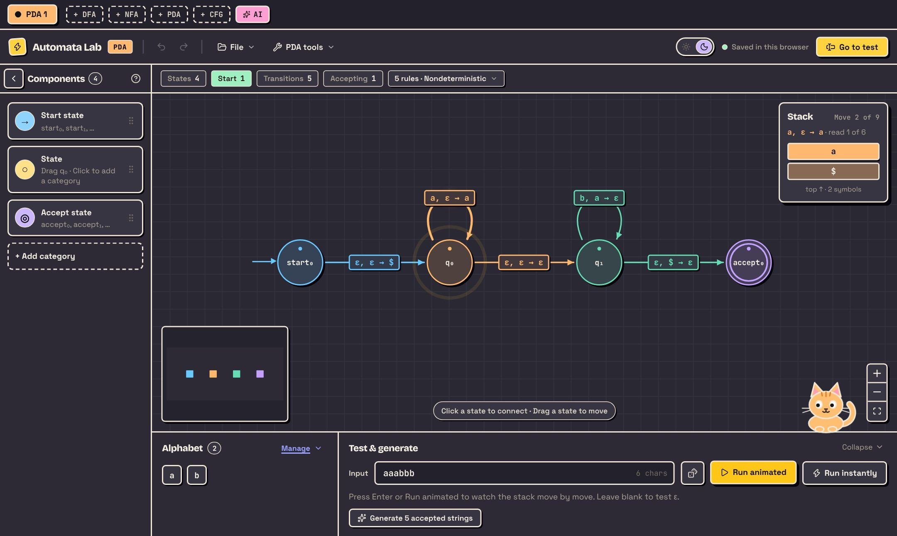
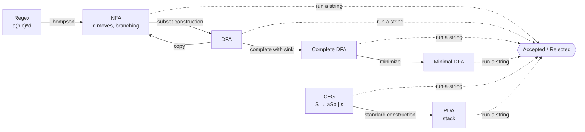
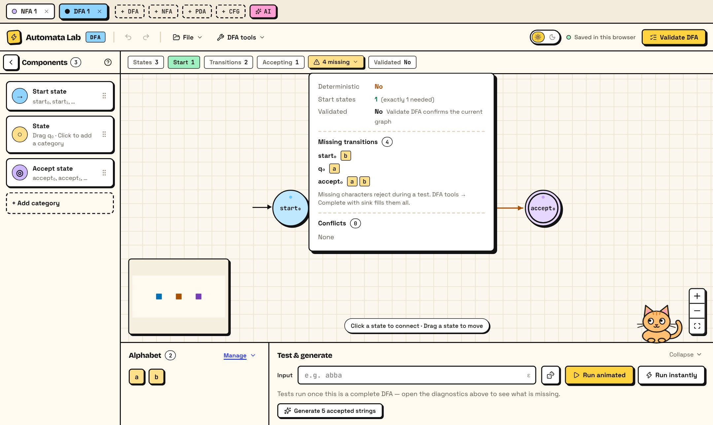

<div align="center">

# ⚡ Automata Lab

**Draw finite and pushdown automata, write grammars. Watch strings walk through them. Convert, minimize, repeat.**

A visual DFA / NFA / PDA / CFG workbench that runs entirely in your browser.

[](https://xiaogao0616.github.io/lumina/)


</div>

---

## What is it?

Think of a whiteboard for **automata theory**. You drag states onto a canvas, click to connect them, and label the arrows. Then type a string and **watch it move through the machine** step by step until it is accepted or rejected. For grammars you type the rules instead, and see the parse tree grow.

It's built for students learning formal languages, TAs who need a quick example, and anyone who wants to check a homework DFA, PDA or grammar before handing it in.

There are four workspaces. They all open as tabs in one window, so you can keep a grammar next to the PDA you built from it.

| Workspace | Open it | What you do there |
| --- | --- | --- |
| **DFA** | [`/dfa`](https://xiaogao0616.github.io/lumina/dfa/) | Draw a deterministic automaton, find missing transitions, complete it with a sink, minimize it |
| **NFA** | [`/nfa`](https://xiaogao0616.github.io/lumina/nfa/) | Use ε-moves and branching, build one from a regex, convert it to a DFA |
| **PDA** | [`/pda`](https://xiaogao0616.github.io/lumina/pda/) | Put stack rules on the arrows and watch the stack change move by move |
| **CFG** | [`/cfg`](https://xiaogao0616.github.io/lumina/cfg/) | Write rules as text, get a parse tree and leftmost derivation, convert to a PDA |

## ✨ Features

<table>
<tr>
<td width="50%" valign="top">

### 🎨 Build
- Drag-and-drop **start / normal / accept** states
- Click a state, then a target, to draw a transition; **multi-select characters** on one arrow
- Custom state categories (`r₀, r₁, …`)
- A start state can also accept
- Drag a state back onto the panel to delete it
- Undo / redo (`Ctrl+Z` / `Ctrl+Shift+Z`)

</td>
<td width="50%" valign="top">

### ▶️ Test
- **Run animated**: the string walks state by state, and NFA branches are tried one at a time
- **Run instantly**: shows the verdict without the walk
- 🎲 Fill in a random string from the alphabet in use
- ✨ **Generate accepted strings**, shortest first; each click shows the next 5 and cycles back to the start
- Live diagnostics: missing transitions, conflicts, ε-moves, branching

</td>
</tr>
<tr>
<td valign="top">

### 🔁 Transform
- **NFA → DFA** by subset construction
- **DFA → NFA** copy
- **Minimize** a DFA (Moore partition refinement)
- **Complete with sink**: fills every missing transition
- **Regex → NFA** with Thompson's construction (`| * + ? ( )`, `\` escapes)

</td>
<td valign="top">

### 💾 Keep
- Browser-style **tabs**: mix as many DFAs, NFAs, PDAs and grammars as you like
- Conversions always open a **new tab** and never overwrite your work
- Every tab is saved automatically in your browser
- Import / export **JSON**
- Export a clean **SVG** for slides and homework

</td>
</tr>
<tr>
<td valign="top">

### 📚 Pushdown automata
- Rules on each arrow read a character, pop a symbol and push a string (`a, X → YZ`), any part ε
- **Stack panel** follows the animated run move by move
- Diagnostics list the rule pairs that make the PDA nondeterministic
- Examples: `aⁿbⁿ` and even palindromes `wwᴿ`

</td>
<td valign="top">

### ✍️ Context-free grammars
- Write rules as text: `S → aSb | ε`
- Test a string and get its **parse tree** and **leftmost derivation**, animated step by step
- Flags undefined, non-productive and unreachable nonterminals
- **CFG → PDA** opens the equivalent PDA in a new tab

</td>
</tr>
</table>

<div align="center">

<br><sub>The stack panel shows the stack after each move while a string runs through a PDA.</sub>
<br><br>

<br><sub>A grammar tab: rules on the left, the parse tree and leftmost derivation of the tested string on the right.</sub>
</div>

### ✦ Build with AI
- Click **✦ AI** at the end of the tab strip, then **describe a language** ("strings over {a, b} ending in ab") or **take / choose a photo** of a hand-drawn diagram or grammar
- Pick DFA, NFA, PDA, CFG, or let the model choose; the result opens in a new tab after the same checks as an imported file (one start state, single-character symbols, a DFA really deterministic, rules that parse)
- Uses your own API key, called straight from the browser: Anthropic (Claude) or any OpenAI-compatible endpoint with a vision model. The key is kept only in this browser's local storage

## 🧭 How the pieces fit



<div align="center">

<br><sub>Diagnostics show exactly which (state, character) pairs are still missing, so you know what's left before the DFA is complete.</sub>
</div>

## 🚀 Try it

**In the browser:** open the [live demo](https://xiaogao0616.github.io/lumina/). There's nothing to install.

**Locally:**

```bash
git clone https://github.com/xiaogao0616/lumina.git
cd lumina
npm install
npm run dev        # → http://localhost:3000
```

<details>
<summary><b>Walkthrough: regex → NFA → minimal DFA</b></summary>

1. Open **NFA** and pick **NFA tools → Regex → NFA…**
2. Type `a(b|c)*d` and press **Generate**.
3. Enter `abcbd` in the input and press **Run animated**. Watch it reach the accept state.
4. **NFA tools → Convert to DFA** opens the deterministic version in a new tab.
5. In that tab, use **DFA tools → Minimize** to see how small the machine can get.

</details>

<details>
<summary><b>Walkthrough: watch a PDA use its stack</b></summary>

1. Open **PDA**. It starts with a machine for `aⁿbⁿ`.
2. Enter `aabb` and press **Run animated**. The stack panel in the corner shows `$` go on first, then one `a` per `a` read, then one popped per `b`.
3. Try `aab`. The run reads every character but ends with an `a` still on the stack, so it never reaches the accept state.
4. Click an arrow to add or remove rules. Leave **Read**, **Pop** or **Push** blank for ε.
5. **PDA tools → Example: Even palindromes wwᴿ** loads a nondeterministic PDA. Open the diagnostics pill above the canvas to see the rule pairs that branch.

</details>

<details>
<summary><b>Walkthrough: from a grammar to a PDA</b></summary>

1. Open **CFG** and pick **CFG tools → Example: Arithmetic expressions**.
2. Enter `x+x*x` and press **Run animated**. The parse tree grows in the same order as the leftmost derivation on the right.
3. Press **Generate 5 strings** a few times. Each click shows the next five, shortest first, and starts over when the list runs out.
4. **CFG tools → Convert to PDA** opens the equivalent PDA in a new tab. Run `x+x*x` there too and watch the stack.

</details>

## 📐 Notation

The PDA and CFG workspaces follow the conventions in Sipser's *Introduction to the Theory of Computation*.

**PDA rules** are written `a, X → YZ`: read `a`, pop `X`, push `YZ`.
- Any of the three parts can be ε, which means "don't read", "don't pop" or "push nothing".
- The pushed string's first character ends up on top, so pushing `YZ` leaves `Y` above `Z`.
- The stack starts empty. Most machines begin with `ε, ε → $` to mark the bottom.
- A string is accepted when all of it has been read and some run is in an accepting state. The stack doesn't have to be empty.
- Runs are searched breadth-first with a cap on stack depth, so an ε-loop that keeps pushing can't freeze the page. If the cap is hit, the result says so.

**Grammars** are written one or more rules per line, like `S → aSb | ε`.
- `->` and `::=` work as well as `→`. The toolbar has buttons for `→`, `ε` and `|`.
- Nonterminals are single uppercase letters `A`–`Z`. Every other character is a terminal, and spaces are ignored.
- `ε` or an empty alternative is the empty string.
- The first rule's left side is the start symbol. Another line for the same letter adds more alternatives.
- Lines starting with `#` or `//` are comments.

## 🧠 Under the hood

All the theory lives in plain, tested TypeScript under [`lib/`](lib/), separate from the UI:

| Module | What it does |
| --- | --- |
| `automata-simulator.ts` | Decides accept / reject, following ε-closures |
| `nfa-to-dfa.ts` | Subset construction; missing moves go to an ∅ sink |
| `dfa-minimize.ts` | Moore / table-filling minimization of reachable states |
| `regex-to-nfa.ts` | Thompson construction for a small regex dialect |
| `automata-dfa.ts` | DFA rules: conflicts, missing transitions, sink completion |
| `path-animation.ts` | Enumerates the walk(s) a string takes, for the animation |
| `accepted-strings.ts` | Lists accepted strings in shortlex order, and pages through them five at a time |
| `graph-svg.ts` | Standalone SVG export using the same edge routing as the canvas |
| `pda.ts` | PDA rules, a bounded breadth-first run with the stack at every move, examples, branching |
| `cfg.ts` | Grammar parsing and checks, Earley membership with a parse tree, string generation, CFG → PDA |
| `editor-storage.ts` | Versioned, validated local saves and tab index |

```bash
npm test           # 89 tests, node --test
npm run typecheck  # route types + tsc --noEmit
npm run build      # static export into out/
```

## 📦 Deployment

Every push to `main` is built as a static export and published to GitHub Pages by [`deploy.yml`](.github/workflows/deploy.yml). The site lives under `/lumina`, so the workflow passes that path to the build as `NEXT_PUBLIC_BASE_PATH`. Locally the variable is empty and the app runs at `/`.

```bash
NEXT_PUBLIC_BASE_PATH=/lumina npm run build   # reproduce the Pages build locally
```

---

<div align="center">
<sub>Built with Next.js and React Flow · Your graphs never leave your browser</sub>
</div>
